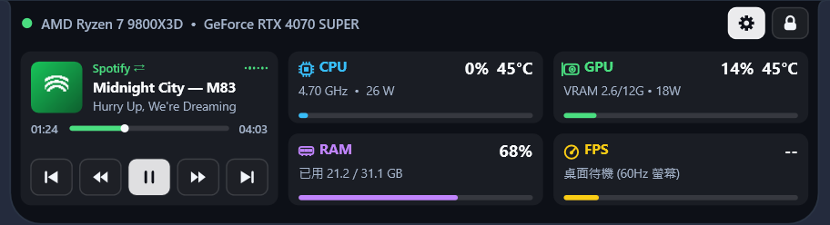
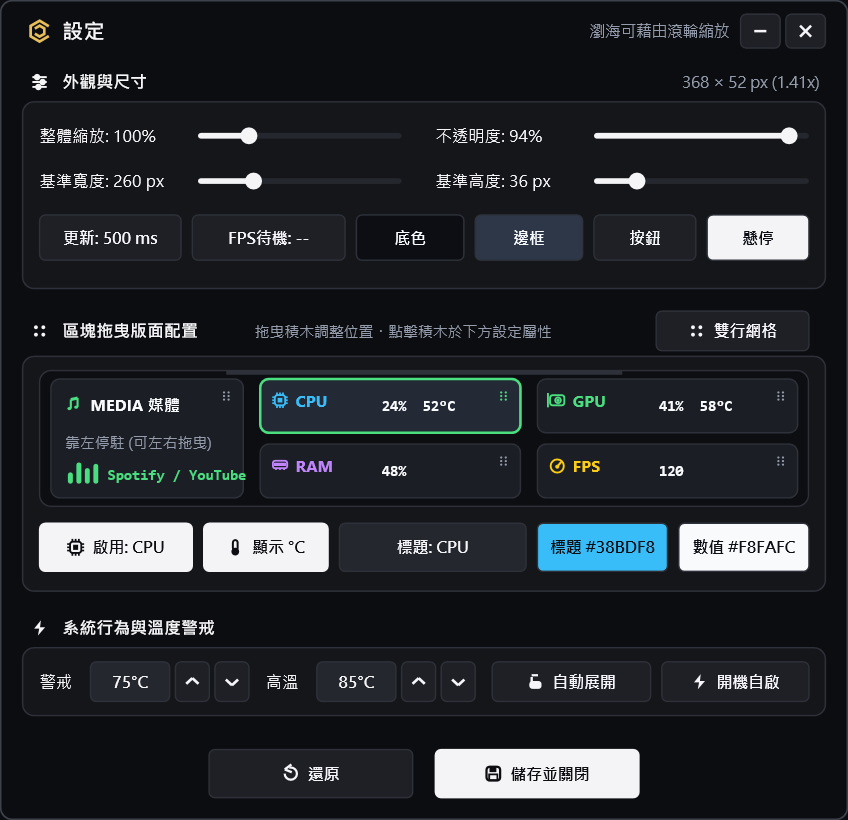

# RCNotchMonitor

<div align="center">

**Windows 頂部動態島硬體監控工具 (Dynamic Island / Notch Hardware Telemetry Monitor)**

[](https://isocpp.org/)
[-0078D6?style=flat-square&logo=windows)](https://www.microsoft.com/windows)
[](#)
[](#)
[](#)
[](LICENSE)

一款以 **C++17 + Win32 API + Direct2D + DirectWrite** 開發的輕量化 Windows 螢幕頂部動態島（Dynamic Island / Notch）硬體效能監視工具。  
無外部執行時期依賴（無須 `.NET Runtime`、`WebView2` 或 `Electron`），單一獨立執行檔約 **900 KB**，常駐記憶體約 **6.4 MB**，支援 60/120 FPS 平滑渲染。

</div>

---

## 介面預覽 (Screenshots)

### 1. 收合狀態：雙行網格模式 (Dual-Row) vs 單行橫條模式 (Single-Row)

| 雙行網格模式 (Dual-Row Grid) | 單行橫條模式 (Single-Row Bar) |
| :---: | :---: |
|  |  |
| 緊湊貼合螢幕頂部，上下兩行整齊對齊 | 依據啟用欄位自動計算寬度，單行橫向膠囊 |

### 2. 滑鼠移入：動態島展開模式 (Expanded Dynamic Island)

<div align="center">
  
</div>

> 滑鼠移入頂部瀏海可觸發 **60 FPS Smoothstep 彈簧動畫** 展開動態島面板，即時展示處理器與顯示卡型號、時脈、功耗、VRAM 佔用、3D 遊戲幀率、系統音樂播放器與音量波形。

### 3. 無邊框設定面板 (Borderless Settings Window)

<div align="center">
  
</div>

### 4. 自訂硬體名稱與個人化色彩 (Custom Labels & Theme)

<div align="center">
  
</div>

---

## 功能與架構

### 1. 雙軌 FPS 偵測架構 (Dual-Engine FPS Monitor)
RCNotchMonitor 具備雙軌 FPS 偵測機制，兼顧精準度與免安裝的便利性：

```mermaid
flowchart TD
    A["遊戲 (DirectX 9/11/12 / Vulkan)"] -->|Present / SwapChain| B["Windows 繪圖管線"]
    
    subgraph RCNotchMonitor["RCNotchMonitor 雙軌引擎"]
        C{"背景是否運行<br/>Afterburner / RTSS？"}
        C -->|是| D["第一軌：直讀共享記憶體<br/>(MAHM / RTSS，即時同步)"]
        C -->|否 (無須安裝額外軟體)| E["第二軌：原生 Windows ETW 引擎<br/>(同 Intel PresentMon 機制)"]
    end
    
    B --> C
    D --> F["即時輸出 FPS 與螢幕 Hz"]
    E --> F
```

- **第一軌：直讀 MSI Afterburner 與 RTSS 共享記憶體**
  - 當系統已運行 MSI Afterburner 或 RivaTuner Statistics Server（RTSS）時，直讀 `MAHMSharedMemory` 與 `RTSSSharedMemory_RTSS_Timer`，數值與其 OSD 保持同步且無額外延遲。
- **第二軌：獨立原生 Windows ETW 核心追蹤**
  - 使用者**無須安裝任何第三方輔助軟體**。透過 Windows 核心事件追蹤機制（`Microsoft-Windows-DXGI`、`D3D9`、`Microsoft-Windows-DxgKrnl` 與 UWP `ApplicationFrameHost` 階層解析），全面支援 DirectX 9/11/12、OpenGL（如 Minecraft Java 版）與 Vulkan / UWP 商店遊戲（如 Minecraft 基岩版）。
  - 採 **100 奈秒（10 MHz）硬體時間戳（`FILETIME`）** 與 **1024 槽位無鎖環狀佇列**，計算 1000ms 滑動視窗幀率，並內建微秒級事件去重機制（0.5ms 去重）。
- **動態 3D 活動判定（無黑名單限制）**
  - 不使用易受干擾的靜態黑名單。改以「該視窗近 1 秒內是否有 3D Present 畫面輸出」動態識別 3D 遊戲；靜態應用（如瀏覽器、記事本、文書工具）自動呈現桌面待機狀態。
- **UWP / 視窗託管自動解析**
  - 針對微軟商店與 Xbox 應用（以 `ApplicationFrameHost.exe` 為前景殼層的遊戲），自動深度遍歷視窗樹並結合 ETW 環狀緩衝區，精準定位底層實際渲染進程。
- **焦點展開保持機制**
  - 點擊展開動態島時，焦點落在靈動島本體（`selfPid`）依然鎖定背景遊戲繼續輸出 FPS，不會輕易中斷當前遊戲幀率輸出。

### 2. 硬體效能監控 (Hardware Telemetry)
背景採用低優先級採樣執行緒，避免影響 UI 渲染流暢度：

| 監控項目 | 收合模式顯示 | 展開島嶼卡片資訊 | 底層資訊來源 (Windows Native APIs) |
| :--- | :--- | :--- | :--- |
| **CPU 處理器** | 使用率 `%` + 溫度 `°C` | 型號、即時時脈 `GHz`、封裝功耗 `W` | `GetSystemTimes`、`CallNtPowerInformation`、LibreHardwareMonitor 橋接 |
| **GPU 顯示卡** | 使用率 `%` + 溫度 `°C` | 型號、VRAM 已用/總量 `GB`、功耗 `W` | NVIDIA NVML (`nvml.dll`) + AMD ADL + DXGI 1.4 記憶體預算 |
| **RAM 記憶體** | 記憶體使用率 `%` | 已用容量 / 總實體記憶體容量 `GB` | `GlobalMemoryStatusEx` |
| **FPS 幀率** | 即時 FPS (4 位數槽位) | 即時 3D 幀率、螢幕更新率 `Hz`、桌面待機狀態 | 雙軌架構：MSI Afterburner/RTSS 共享記憶體 + 原生 Windows ETW（DXGI / D3D9 / DxgKrnl / UWP） |
| **媒體控制** | 專輯封面微縮膠囊 | 專輯封面、曲名、演唱者、進度條、播放控制 | Windows GSMTC (`Windows.Media.Control`) + WASAPI CoreAudio |

### 3. Windows 媒體控制與音量視覺化 (GSMTC + WASAPI)
- **多平台播放器整合**：支援 Spotify、Apple Music、YouTube、Edge、Chrome、Firefox、PotPlayer 等支援 Windows 媒體傳輸控制的應用程式。
- **Direct2D 封面渲染**：即時擷取專輯封面點陣圖，以雙線性內插濾波繪製圓角封面。
- **即時音量峰值儀 (WASAPI Peak Meter)**：透過 Windows Audio Session API 實體聲道取樣，將音量動態反映至進度條。
- **互動控制**：展開狀態支援上一首、播放/暫停、下一首、滑鼠拖動進度條與鍵盤快進快退。

### 4. UI 介面細節與防抖動設計 (4px Grid & Typography)
- **4px 偶數網格系統**：所有視窗尺寸、內距（Padding）、圓角半徑、滑桿步進值遵循 `4px` 偶數規範。
- **固定寬度對齊槽位**：使用率（`100%`）、FPS（`9999`）與溫度（`99°C`）預留固定寬度槽位並向右對齊，數值變動時標籤與圖示維持位置不晃動。
- **滑鼠滾輪縮放**：將滑鼠移至頂部瀏海滾動**滑鼠滾輪**，可在 `50%` ~ `250%` 間無段調整大小，底層透過 Windows 分層視窗（`UpdateLayeredWindow`）平滑縮放。
- **字體階層**：設定面板採用 `24px`（標題）、`20px`（副標題/區塊頭）、`16px`（正文）字階，支援全局字型切換。
- **拖曳排序 (Drag-to-Reorder)**：支援按住卡片右側拖曳圖示調整 CPU / GPU / RAM / FPS 顯示順序，伴隨 60 FPS 補間動畫平滑讓位。

---

## 快捷鍵與滑鼠操作 (Shortcuts & Gestures)

| 操作方式 | 觸發位置 | 功能說明 |
| :--- | :--- | :--- |
| **`Ctrl + Alt + S`** | 全域快捷鍵 | 開啟／關閉「設定」視窗 |
| **`Ctrl + Alt + N`** | 全域快捷鍵 | 切換「鎖定滑鼠穿透」（鎖定後滑鼠直接穿透瀏海點擊底層遊戲/視窗） |
| **滾動滑鼠滾輪** | 頂部動態島上方 | 以 `4%` 為單位即時放大或縮小瀏海尺寸（`50%` ~ `250%`） |
| **滑鼠移入 / 移出** | 頂部動態島上方 | 自動展開動態島詳細面板；移出自動收合（穿透模式下不觸發） |
| **左鍵單擊圖示** | 系統匣 (System Tray) | 開啟設定面板 |
| **右鍵點擊圖示** | 系統匣 (System Tray) | 開啟快速功能選單（切換佈局、重載配置、鎖定穿透、結束程式） |

---

## 專案結構 (Project Structure)

```text
RCNotchMonitor/
├── .github/
│   └── workflows/
│       └── build-and-sign.yml   # GitHub Actions CI 自動化建置腳本
├── docs/
│   └── images/                  # README 介面預覽圖示
├── src/
│   ├── main.cpp                 # 程式進入點、系統匣常駐、全域快捷鍵、單一實例與無頭測試 (--verify)
│   ├── config.h / .cpp          # JSON 設定檔讀寫、4px 網格校正、深色極簡主題
│   ├── telemetry.h / .cpp       # CPU / GPU (NVML/ADL) / RAM / 雙軌 ETW+RTSS FPS / GSMTC 遙測引擎
│   ├── notch_window.h / .cpp    # Direct2D 頂部動態島收合與 60FPS 彈簧展開動畫渲染器
│   ├── settings_window.h / .cpp # Direct2D 無邊框設定視窗、卡片拖曳排序與調色控制器
│   ├── smtc_com.h               # 原生 GSMTC (Windows.Media.Control) COM 介面定義
│   ├── fa_icons.h               # 幾何演算法繪製之向量圖示庫
│   ├── monitor_utils.h          # 螢幕解析度與 DPI 動態縮放計算工具
│   ├── sensor_bridge.cs         # 備用之硬體溫度檢測橋接模組
│   ├── app.ico                  # 應用程式多解析度圖示
│   ├── app.rc                   # Windows 資源檔 (嵌入應用程式圖示與版本號資訊)
│   └── app.manifest             # 宣告 requireAdministrator 確保 ETW 繪圖核心追蹤權限
├── build.ps1                    # 一鍵快速編譯腳本 (支援本機 w64devkit 與 MinGW-w64)
├── convert_png.ps1              # 資源圖示轉換工具
├── .gitignore                   # Git 版本控制忽略清單
├── LICENSE                      # MIT 開源授權條款
└── README.md                    # 專案技術說明文件
```

---

## 從原始碼編譯 (Build from Source)

### 系統與編譯器需求
- **作業系統**：Windows 10 / Windows 11 (64-bit)
- **編譯器**：MinGW-w64 (`g++.exe` 支援 C++17 與 `windres.exe`)
  - 建議使用免安裝的 [w64devkit](https://github.com/skeeto/w64devkit)，解壓至 `deps\w64devkit` 或加入系統 `PATH`。

### 執行編譯
在專案根目錄開啟 PowerShell 並執行：
```powershell
powershell -ExecutionPolicy Bypass -File .\build.ps1
```

編譯成功後，輸出的執行檔位於：
```text
dist\RCNotchMonitor.exe
```

### 自動檢測與截圖驗證
`RCNotchMonitor.exe` 內建無頭驗證模式（`--verify`），可在背景測試感測器與渲染器，並輸出 5 張介面渲染圖供檢視：
```powershell
.\dist\RCNotchMonitor.exe --verify .\verify_out
```

---

## 設定檔規格 (`config.json`)

程式首次啟動時會在同目錄下自動產生並載入 `config.json`，數值會自動校正為偶數：
```json
{
  "configVersion": 4,
  "scalePercent": 100,
  "notchWidth": 260,
  "notchHeight": 36,
  "fontSizePt": 12,
  "opacityPercent": 96,
  "layoutMode": 0,
  "refreshIntervalMs": 500,
  "bgColor": "0C0E14",
  "borderColor": "262936",
  "btnColor": "1E2026",
  "btnHoverColor": "F4F4F6",
  "tempWarnC": 75,
  "tempCritC": 85,
  "clickThroughLocked": false,
  "autoStartAdmin": false,
  "showDesktopFpsDash": true
}
```

---

## 隱私權說明 (Privacy Policy)

本程式（`RCNotchMonitor.exe`）為本地單機應用，不收集、傳輸或儲存任何使用者個人資訊、使用行為或遠端遙測資料。所有硬體感測器讀數僅在記憶體中即時計算與顯示，使用者偏好設定僅儲存於本地 `config.json` 中。

---

## 開源條款 (License)

本專案採用 [MIT License](LICENSE) 開源授權，歡迎自由使用、修改、Fork 或提交 Issue / Pull Request。
